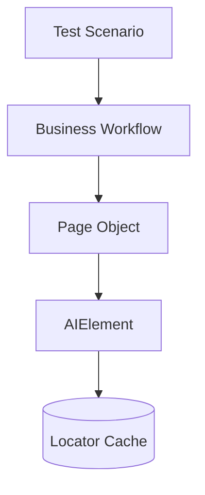

---
name: test-architecture
description: Layered test design - which layer may call which, where locators are allowed to live, and how dependency direction and locator isolation are enforced. Use when placing new test code into a layer, or when detecting or fixing violations such as direct page.locator calls, skipped layers, or cross-business calls.
---

# Test Architecture - Layered Design

Defines layered architecture for test automation: who may call whom, where locators live, and how dynamic elements are handled. Use this so generated tests stay consistent and maintainable.

## When to Use This Skill

The agent should read this skill during **test generation**, **refactors**, or **reviews** when it needs to:

- Place new code in the correct folder and layer (scenario vs business vs page object)
- Decide whether a locator, `this.page`, or `AIElement` is allowed
- Enforce **dependency direction** and **locator isolation**
- Explain or fix violations (direct locators, skipped layers, cross-business calls)

---

## Layer Hierarchy

Flow is always **down** the stack; a layer calls only the layer **directly below** it.

```
Test Scenario (tests/TestScenario/)
        │
        ▼ calls
Business Workflow (tests/Business/)
        │
        ▼ calls
Page Object (tests/Functional/)
        │
        ▼ uses
AIElement ({config.importBasePath}/AIElement.ts)
        │
        ▼ reads / resolves
Locator Cache (tests/Utils/locator_cache.json)
```

Equivalent chain in one line:

**Test Scenario → Business Workflow → Page Object → AIElement → Locator Cache**



---

## Layer Responsibilities

| Layer | Location | Responsibility | Allowed | Must not |
| ----- | -------- | -------------- | ------- | -------- |
| **Test Scenario** | `tests/TestScenario/` | High-level test flow | Call **Business** only; `TestLogger.testStep()`; `SettingsHelper` for URLs/credentials/config; construct workflow instances | Direct locators; `this.page.*`; direct **Page Object** calls; hardcoded URLs/credentials |
| **Business Workflow** | `tests/Business/` | Domain orchestration | Call **Page Objects** only; extend `AIPage`; `TestLogger.businessStep()`; Split+Merge for reuse | Direct locators; `this.page.*`; **cross-business** calls; changing behavior by editing shared methods without Split+Merge |
| **Page Object** | `tests/Functional/` | UI actions on one page | Extend `AIPage`; **all** interactions via `AIElement`; `TestLogger.pageStep()`; init elements with cache keys + descriptions | Direct locators; **`this.page.locator` / click / fill**; any Playwright use outside what `AIPage`/framework allows |
| **AIElement** | `{config.importBasePath}/AIElement.ts` | Resolve cache + execute interactions | Resolve from cache; click/fill/etc.; `TestLogger.elementStep()`; throw `LocatorNotFoundError` on cache miss | N/A (this **is** the locator boundary) |
| **Locator Cache** | `tests/Utils/locator_cache.json` | Centralized locator definitions | JSON structure per page/element keys | Hand-editing without following locator management rules for the project |

**Locator rule of thumb:** Only **AIElement** resolves and drives Playwright locators from the cache. Page objects hold `AIElement` instances, not raw selectors.

### AIElement: single gateway

- **AIElement** is the **only** class that reads locator definitions from the cache for element actions.
- **AIElement** is the **only** place that should apply Playwright **locator** APIs for those cached elements (click, fill, hover, visibility, etc.), per your shared implementation in `{config.importBasePath}/AIElement.ts`.
- Page objects **construct** `AIElement` with `(pageOrAIPageRef, 'cacheKey', 'Natural language description for AI/debug')`. Descriptions should be specific (for example: “Submit button at the bottom of the registration form”).

### Locator cache shape (reference)

Pages group keys under a logical page id. Each locator entry has metadata and a `LocatorStep[]` Playwright API chain (or a legacy CSS/XPath string for backward compatibility). Dynamic locators use `{param}` inside step args. Exact schema is defined by your **Locator Management** rules; keep JSON as the **single source** for locator definitions.

---

## Imports and `{config.importBasePath}`

Generated or hand-written tests should import shared framework types and classes from the configured base, **not** from hardcoded paths like `Engine/Shared`:

```typescript
import { AIElement } from '{config.importBasePath}/AIElement';
import { AIPage } from '{config.importBasePath}/AIPage';
import { TestLogger } from '{config.importBasePath}/TestLogger';
import { LocatorContextType } from '{config.importBasePath}/types';
```

Replace `{config.importBasePath}` when emitting files (for example from `.workplace/test-generation/config.json`).

---

## Prohibited Patterns (Summary)

| Layer | MUST NOT |
| ----- | -------- |
| Test Scenario | Use locators or `page.click` / `page.fill`; call page objects directly; embed secrets or raw base URLs |
| Business | Use locators or direct `this.page` APIs; call another business class; bypass page objects |
| Page Object | Use `this.page.locator(...)` or string-interpolated locators; interact without `AIElement` |
| Any high-level code | Skip layers (e.g. test calling a page object); put selectors in TypeScript instead of cache |
| Dynamic UI | `this.page.locator(\`...\${var}\`)` — use **AIElement** + `{param}` and `LocatorContextType` (see `references/dynamic-elements.md`) |

---

## Key Principles

1. **Single responsibility** — Each layer has one job: orchestrate test, orchestrate domain steps, perform page UI, resolve/execute on elements, or store locators.
2. **Dependency direction** — Calls go **down** the hierarchy only (scenario → business → page → element → cache).
3. **Locator isolation** — Only **AIElement** reads the cache and talks to Playwright locators for element actions.
4. **No skipping** — Scenarios do not call page objects; business does not call `AIElement` directly; keep the chain intact.
5. **Business independence** — Business classes do **not** call each other; the test scenario composes multiple workflows if needed. For API tests this is the norm rather than the exception: split one large flow into **per-resource-domain** workflows and let the scenario compose them and thread data between calls (see `test-api-integration`).

---

## Split + Merge (Reuse)

When reusing part of an existing workflow or page method:

- Extract **small public** steps.
- Rebuild the original method from those steps.
- Add new flows by **composing** steps — avoid copy-paste and avoid silently widening one method for unrelated cases.

Detailed reuse analysis may live in project Phase 0 / reusability docs; this skill only requires the **pattern**.

---

## Dynamic Elements

**Rule:** Never `this.page.locator()` with string interpolation for dynamic parts. Use **AIElement** with a `{param}` placeholder inside `LocatorStep[]` args in the cache and `LocatorContextType` in code.

See **`references/dynamic-elements.md`** for imports (`{config.importBasePath}/types`), cache shape, `locate()` for repeated actions, and `WithinDynamicParent`.

---

## Examples and Anti-Patterns

End-to-end login flow, wrong vs right snippets, and business independence live in:

- **`references/layer-flow-examples.md`**

---

## Quick Compliance Checklist

- [ ] Scenarios: only business + `TestLogger.testStep` + settings helpers — no locators, no direct `page` element APIs, no direct page classes
- [ ] Business: only page objects + `TestLogger.businessStep` — no cross-business, no raw page/locators
- [ ] Page objects: only `AIElement` for element actions + `TestLogger.pageStep` — no `this.page.locator`/fill/click for elements
- [ ] Locators only in **cache**, resolved only through **AIElement**
- [ ] Dynamic text/rows: `{param}` in `LocatorStep[]` args + `LocatorContextType`, not interpolated `page.locator` strings

---

## Architecture Compliance Checklist (detailed)

- [ ] Test scenarios **only** call Business layer methods
- [ ] Test scenarios contain **no** direct locators (CSS, XPath, role+name hacks in test files, etc.)
- [ ] Test scenarios have **no** direct Playwright element interactions (`page.click`, `page.fill`, …) for UI under test
- [ ] Business workflows **only** call Page Object methods
- [ ] Business workflows contain **no** direct locators
- [ ] Business workflows have **no** direct `this.page` element APIs for UI under test
- [ ] Business workflows have **no** cross-business calls
- [ ] Page Objects use **AIElement** for **all** element interactions
- [ ] Page Objects contain **no** direct locators in TypeScript
- [ ] Page Objects have **no** direct `this.page.locator` / fill / click for cached elements
- [ ] **AIElement** is the **only** class accessing locators from the cache for those interactions
- [ ] Call hierarchy is preserved end-to-end (no skipped layers)

---

## Success Criteria

- **Proper layering:** Test → Business → Page Objects → AIElement → Cache
- **No direct locators** in scenario, business, or page object layers for elements that belong in the cache
- **No forbidden page access:** No raw `this.page` element choreography in business or page object layers where `AIElement` is required
- **Single responsibility:** Each layer stays within its role
- **Maintainability:** Clear boundaries make refactors localized
- **Testability:** Layers can be reasoned about and extended independently when the framework allows

---

## Related Project Assets

- Locator structure and parameterized keys: project **Locator Management** / cache conventions
- Test generation pipeline: `.cursor/skills/test-generation-orchestrator/SKILL.md`

When `importBasePath` is configured in module or project config, resolve `{config.importBasePath}` to the real folder (for example shared engine root) before emitting imports in generated code.
