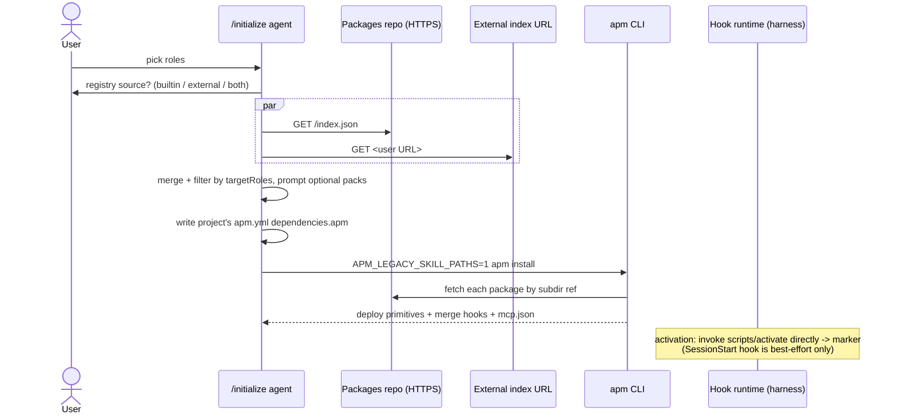

# APM Workflow — Single Source of Truth

> Canonical reference for the entire APM-based package lifecycle inside the AI Workplace template. Every APM-aware command, skill, agent, and rule **MUST** link here instead of duplicating the procedure. If you edit this file, also bump the relevant section number in any link that cites it.
>
> **Verified against APM 0.28.0** (2026-08-07 doc refresh + isolated smoke test of `apm-cli==0.28.0`; `.cursor/rules/.core-version.json → apmVersionExpected`). Facts below were re-checked against the upstream 0.28.0 [release notes](https://github.com/microsoft/apm/releases/tag/v0.28.0), the current docs at <https://microsoft.github.io/apm/>, and hands-on runs. Net result: the **dict-form dependency** (`git:`/`path:`/`ref:`) and **`APM_LEGACY_SKILL_PATHS=1`** contract Workplace relies on are unchanged. What changed materially at this baseline: (1) **`AGENTS.md` co-ownership is `compilation.agents_md.mode: managed_section`** — `apm compile` does NOT emit the per-package `<!-- APM:<name> begin/end -->` markers the pre-v4.5.0 template assumed; APM manages only the `<!-- apm:start -->` / `<!-- apm:end -->` region (Section 5); (2) **`SessionStart` IS now written into `.cursor/hooks.json`** but verbatim in the Claude event shape with the extensionless `${PLUGIN_ROOT}` script reference unresolved, so direct script invocation remains the supported activation path (Sections 3 and 6); (3) **new targets `grok-build` (first-class) and `grok-cloud` (experimental)** (Section 1); (4) `--legacy-skill-paths` is accepted by `install`, `compile`, and `pack` — **not** `update` — so the env var stays canonical (Section 5); (5) aliased dependencies re-download after a manifest `ref:` bump, and `apm pack` no longer fails on empty dependency lists (Section 8). Carried forward from the 0.26.0 refresh: TLS verifies against the **OS trust store by default** (Section 10), and **target resolution keeps the `apm.yml targets:` step** with manifest-level `all` deprecated (Section 4).

---

## 1. Overview

The AI Workplace is built on top of the **Agent Package Manager (APM)** — Microsoft's dependency manager for AI agent configuration. APM installs packaged primitives (instructions, prompts, agents, skills, hooks, MCP servers) into the harness directories every supported AI assistant understands. Valid `--target` values for `apm compile`/`apm install` on 0.28.0 are: `copilot`, `claude`, `cursor`, `opencode`, `codex`, `gemini`, `antigravity`, `windsurf`, `kiro`, `intellij`, `vscode`, `grok-build`, `agent-skills`, `all`.

- `all` **excludes** `agent-skills`, `antigravity`, and `intellij` — combine them explicitly (`--target all,intellij`) to include them.
- `intellij` (GitHub Copilot for JetBrains IDEs) is a first-class target: its file primitives deploy through the Copilot profile (`.github/…` plus `.agents/skills/`) while the IntelliJ-specific adapter writes JetBrains Copilot's user-scope MCP config. `--runtime intellij` still works but is only a **legacy single-value alias** for `--target`.
- `grok-build` (new in 0.28.0) is a first-class target: it auto-detects on a `.grok/` directory and is included in the `all` expansion. Skills deploy to Grok's native `.grok/skills/` path (like Claude's `.claude/skills/` and Kiro's `.kiro/skills/`, it is unaffected by the legacy-paths variable).
- `copilot-cowork`, `copilot-app`, `openclaw`, `hermes`, and `grok-cloud` are **experimental** targets: they need `apm experimental enable <name>` and are not valid in a manifest's top-level `target:` / `targets:` enum (see Section 4). They are outside the Workplace support baseline.

See the upstream [Targets matrix](https://microsoft.github.io/apm/reference/targets-matrix/) for the current, authoritative per-harness matrix.

Why APM here:

- One source of truth for every Workplace package (role-pack, full module, or single skill) lives in the standalone **Workplace-Agent-Packages** repo (<https://git.netcracker.com/DEMO.SE.AI/Workplace-Agent-Packages.git>), one `<id>/` directory per package at the repo root. The URL is recorded in `.cursor/rules/.core-version.json → apmPackages.registryRepoUrl`.
- Cross-harness installability is handled by APM — Workplace does not maintain per-harness shims.
- Reproducible installs via `apm.lock.yaml`.
- Activation logic for full modules lives in idempotent `scripts/activate.{sh,ps1}`. Packages also ship a `.apm/hooks/activate.json` descriptor; on 0.28.0 APM does copy its `SessionStart` event into `.cursor/hooks.json`, but verbatim in the Claude shape that Cursor does not execute (Section 3), so **direct invocation of the script is the reliable path** — see Section 6 (it is **not** `apm run activate -p <pkg>`; that command does not exist upstream).

Upstream documentation index: <https://microsoft.github.io/apm/>.

---

## 2. APM CLI installation (Phase 0 gate)

Every initializer / updater flow that touches APM (`/initialize`, `/quick-init`, `/package-new`, `/update-workplace`) **MUST** run the following gate before any APM call:

```text
apm --version   # exit 0 + semver -> continue
                # not found       -> install, then re-check
                # still fails     -> abort with link to upstream installer
                #                   (exception: /quick-init degrades gracefully —
                #                    apmAvailable=false, package offer skipped)
```

| OS | Primary install command | Alternatives |
|---|---|---|
| macOS / Linux | `curl -sSL https://aka.ms/apm-unix | sh` | `brew install microsoft/apm/apm`, `pip install apm-cli` |
| Windows (PowerShell) | `irm https://aka.ms/apm-windows | iex` | `pip install apm-cli` |

The agent **offers to install automatically** by running the platform-appropriate primary command via the Shell tool, **only after the user explicitly consents**. If the user declines, or the auto-install fails, the agent falls back to printing the same commands verbatim and waits for the user to install manually.

> **URL rule (strict).** The agent MUST use the commands above **verbatim**. URLs like `apm.run/install.ps1`, `install.apm.dev`, or any other domain are NOT valid — only `aka.ms/apm-windows`, `aka.ms/apm-unix`, the registered `brew install microsoft/apm/apm` tap, and `pip install apm-cli` are authoritative. The single source for these is <https://microsoft.github.io/apm/getting-started/installation/>.

To install the **exact Workplace baseline** rather than whatever is newest upstream, pin it: `python -m pip install "apm-cli==0.28.0"` (any OS, needs Python 3.10+), or `$env:VERSION = "v0.28.0"; irm https://aka.ms/apm-windows | iex` / `curl -sSL https://aka.ms/apm-unix | sh -s -- @v0.28.0`. The bare one-liners always track the latest release and are therefore not a pin.

After install, re-run `apm --version` (on a fresh shell or with the absolute path `$env:USERPROFILE\.apm\bin\apm.exe` / `~/.apm/bin/apm`). On Windows the installer now adds both `current` and `bin` to `PATH` with the stable `current\apm.exe` **first**, so a bare `apm` call resolves the real executable in PowerShell, Git Bash, and `subprocess.run(["apm", ...])`; `bin\apm.cmd` remains only for compatibility. On success, write the detected version to `.cursor/rules/.core-version.json` under `apmVersion`. On Windows PowerShell 5.1, do not round-trip this manifest through `Get-Content | ConvertFrom-Json | ConvertTo-Json | Set-Content`; write it as UTF-8 without BOM using the Write tool, Node `fs.writeFileSync(..., 'utf-8')`, or `[System.IO.File]::WriteAllText(..., New-Object System.Text.UTF8Encoding $false)`. On major-version drift (e.g. CLI 2.x vs Workplace expects 0.x) warn the user and offer to abort. Once installed, `apm self-update` (`--check` to only check) upgrades the CLI in place — prefer it over re-running the install one-liner on an existing install. **Caveat:** `apm self-update` is a no-op on CLIs installed via a package manager (e.g. `brew`) — those distributions disable it at build time and print their own upgrade message instead (`brew upgrade microsoft/apm/apm`). It is unclear whether the `pip install apm-cli` distribution is affected the same way; if `apm self-update` reports it is disabled, fall back to the same command originally used to install (`pip install --upgrade apm-cli`, `brew upgrade microsoft/apm/apm`, or re-running the platform one-liner). Because Workplace declares a specific baseline, do not run an unpinned `self-update` on a working project until the newer release has been validated and `apmVersionExpected` bumped.

**When the gate fails for a non-obvious reason, run `apm doctor`** before guessing. It prints a pass/fail table for git availability, network reachability (a `git ls-remote` probe that can take up to five seconds), credential resolution, marketplace config parsing, and executable-trust overrides. Only the git and network checks affect its exit code; the rest are informational. `apm doctor --verbose` adds the underlying diagnostics.

Full operational checklist (consent dialog, fallback, drift handling): [`apm-bootstrap.md`](apm-bootstrap.md).

Upstream installer page: <https://microsoft.github.io/apm/getting-started/installation/>.

---

## 3. Package layout for AI Workplace

Every Workplace package lives at the root of the Workplace-Agent-Packages repo as `<id>/` and has this shape:

```
<id>/
  apm.yml
  README.md
  .apm/
    agents/<name>.agent.md           # cross-harness agent primitive
    skills/<name>/SKILL.md            # + optional references/, assets/, scripts/
    instructions/<name>.instructions.md  # compiled into AGENTS.md by apm compile
    prompts/<name>.prompt.md          # surfaced as slash commands per target
    hooks/activate.json               # SessionStart hook, one-shot
  scripts/
    activate.sh                       # POSIX activation logic
    activate.ps1                      # Windows sibling, same contract
  runtime/                            # optional, modules only
```

### `apm.yml` — the manifest

The mandatory fields are the standard APM ones (`name`, `version`, `description`, `author`, `license`, `dependencies.apm`, `dependencies.mcp`, `scripts`). Workplace adds **one** extra top-level block:

```yaml
x-workplace:
  schemaVersion: 1
  type: role-pack | module | skill
  targetRoles: []        # roles that auto-activate this package in Phase 1.7-APM
  optional: false        # true => offered in Pass A.5 (batched yes/no)
  standaloneOnly: false  # true => never offered during /initialize; offered by /quick-init Step 4.5 (empty targetRoles) or manual
  contextSkills: []      # *-context skills whose guidelines.md is mandatory
  activate:              # modules only
    script: scripts/activate.sh
    markerFile: .workplace/activated/<name>.marker
    movesRuntimeFolder: true
```

APM ignores unknown top-level keys, so the block survives `apm install` unchanged (the [manifest schema](https://microsoft.github.io/apm/reference/manifest-schema/) §2 states "Unknown top-level keys MUST be preserved by writers but MAY be ignored by resolvers" — unchanged through 0.28.0; there is still no native APM equivalent of `x-workplace`, so this stays a Workplace-only convention). Its schema is `_schema/x-workplace.schema.json` in the Workplace-Agent-Packages repo; that repo's CI rejects any `apm.yml` whose block fails validation.

> **Hook event names — confirmed constraint (re-verified on 0.28.0, mechanism corrected).** `.apm/hooks/*.json` files are keyed by lifecycle event name, and upstream's [hooks authoring reference](https://microsoft.github.io/apm/producer/author-primitives/hooks-and-commands/) is explicit on the contract: APM rewrites **only** the Claude (`PreToolUse`, `PostToolUse`) and Copilot (`preToolUse`, `postToolUse`) shapes to native per-target casing during merge. **What 0.28.0 changed:** an unrecognized event such as `SessionStart` is no longer silently dropped — it is copied into the target's hook file **verbatim, in the source (Claude) shape**. Smoke test on 0.28.0: a package's `SessionStart` entry landed in `.cursor/hooks.json` with PascalCase keys and nested `hooks` arrays, and the extensionless `${PLUGIN_ROOT}/scripts/activate` command reference stayed unresolved (the package ships only `activate.ps1` / `activate.sh`). Cursor's hooks schema expects camelCase events with flat entries, so the merged entry is **inert** — and OpenCode still has no hooks concept at all. Related facts unchanged: APM writes an `apm-hooks.json` **ownership sidecar** beside every merged hook config (Claude, Cursor, Gemini, Codex, Windsurf, Antigravity) that must not be hand-edited, and dropping a target from `targets:` makes the next install/compile/update remove that target's hook entries and sidecar. **Practical consequence for modules: rely on direct invocation of the deployed `scripts/activate.{sh,ps1}` (Section 6), not on a session event.**
>
> **Native replacement to adopt for the `module` type (evaluated, not yet applied).** APM ships a harness-independent primitive for exactly this one-shot-activation use case: [`apm lifecycle`](https://microsoft.github.io/apm/reference/cli/lifecycle/) scripts (a `lifecycle:` block in `apm.yml`; events `pre-install`, `post-install`, `pre-update`, `post-update`, `pre-uninstall`, `post-uninstall`). A `post-install` script fires **during `apm install` itself**, inside the APM CLI process, so it depends on no harness hook support and no event-name mapping. It is now a full command group — `apm lifecycle init` scaffolds the block, `validate` checks the schema, `test [EVENT] [--execute]` fires a synthetic event, and `trust` / `untrust` manage consent. The one operational catch: **project-source lifecycle scripts are skipped until the consumer runs `apm lifecycle trust`** (trust is bound to a SHA-256 of the `lifecycle:` subtree, so editing it revokes trust), and `APM_NO_SCRIPTS=1` or an org `executables.deny_all: true` suppresses them entirely. Switching the `module` package type over is an architecture change requiring a decision on that trust step — **still out of scope for a doc-accuracy pass**, but it is now the recommended direction rather than merely "worth evaluating."
>
> **Executable-trust gate (opt-in).** `apm install` can gate dependency-provided hooks / `bin/` executables / self-defined MCP servers / canvas extensions behind an `executables:` allow-list in the consumer's `apm.yml` OR an org policy, managed with `apm approve` / `apm deny` ([reference](https://microsoft.github.io/apm/reference/cli/approve/)). The gate activates only when one of those layers declares a non-empty `executables:` block; otherwise executables deploy unconditionally. Workplace-generated `apm.yml` files declare none, so packages shipping `scripts/activate.*` install without extra approval today. If a future Workplace release or an org policy turns the gate on, activation will need an explicit `apm approve <package>`. Use `apm policy explain` to see which layer produced a given decision.

| Field | Meaning |
|---|---|
| `schemaVersion` | Hard version of the `x-workplace` schema. Always `1` today; bumped only on breaking changes. |
| `type` | Package shape: `role-pack` (lightweight bundle), `module` (full module with `scripts/activate.*`), or `skill` (single shareable skill). |
| `targetRoles` | Roles that intersect-match selected roles during `/initialize` Phase 1.7-APM. Empty array + `optional: true` => never auto-selected. |
| `optional` | Offered in Pass A.5 with a batched yes/no prompt rather than auto-activating. |
| `standaloneOnly` | Skipped entirely during `/initialize`; user must add the dependency manually via `apm install` or editing `apm.yml`. |
| `contextSkills` | Names of `*-context` skills whose `references/guidelines.md` MUST be rendered before the package counts as active (Phase 6 Part 3.5 gate, preserved verbatim). |
| `activate.*` | Module activation contract — see Section 6. |

---

## 4. Registry sources (Phase 1.7-APM)

The package catalogue lives in a separate repo, so it is **not** locally available in the consumer project at init time. The initializer fetches the registry index over HTTPS instead. Three modes:

| Mode | Source of `index.json` | When to use |
|---|---|---|
| **Built-in Workplace** (default) | Raw file from the Workplace-Agent-Packages repo URL stored in `.cursor/rules/.core-version.json → apmPackages.registryRepoUrl`. URL pattern: `{repo}/raw/{branch}/index.json`. | Standard initialization. |
| **External URL** | One or more user-supplied URLs to JSON documents matching the `_schema/index.schema.json` contract. May be GitHub/GitLab raw URLs, `https://`, or anything reachable from the agent's host. | Org-internal mirrors, private package catalogs, forks. |
| **Both (merged)** | Built-in + one or more external URLs. Entries merged by `name`. On conflict the built-in wins by default; user can override per package. | Internal packs layered on top of the canonical catalogue. |

### Built-in source resolution ladder

The initializer's `prepare-apm-packages.ps1` script tries these sources **in order** and stops on first success:

1. **HTTPS raw URL** — `<apmPackages.registryRepoUrl-without-.git>/raw/<branch>/index.json`. Works on GitHub, GitLab, Bitbucket, etc.
2. **Authenticated git clone** — `git clone --depth 1 --filter=blob:none --sparse` of `apmPackages.registryRepoUrl` (a `--sparse` clone checks out the repo's root-level files, including `index.json`). Used automatically when the HTTPS response was an HTML auth-wall page **or** the user / agent passes `-AllowGitFallback`. This uses the host's existing credentials (Git Credential Manager, SSH key, PAT). The clone goes to `.cursor/.tmp-apm-clone/` and is cleaned up at the end of the phase.
3. **Offline snapshot** at `.cursor/rules/packages-index.json` — shipped by the template, refreshed by `/update-workplace`. Warns the user that the snapshot may be stale.

Each script run records which step won under `sources[].resolvedVia` in `.cursor/.temp-apm-selection.json` (`https-raw` / `git-clone` / `https-external` / `offline-snapshot`). The initializer logs this value in `project_init.md` Decision Log §1.7.

HTML responses from a private registry (typical GitLab/Bitbucket login page returned at 200 OK) are detected by content-sniffing the response body and `Content-Type` header — the script will not feed HTML through `ConvertFrom-Json`. Instead it emits a clear "auth wall" diagnostic and proposes either `-AllowGitFallback`, an external mirror URL, or refreshing the offline snapshot manually.

### Index schema

The fields per entry are `name`, `version`, `description`, `path`, optional `ref`, and the embedded `xWorkplace` block. The initializer translates each accepted entry into an APM **dict-form (object-form) dependency** in the project's `apm.yml` (see Phase 1.7-APM Step 4 and the upstream [manifest schema](https://microsoft.github.io/apm/reference/manifest-schema/) / [Object Form reference](https://microsoft.github.io/apm/consumer/manage-dependencies/)):

```yaml
dependencies:
  apm:
    - git: <apmPackages.registryRepoUrl>   # Workplace-Agent-Packages repo .git URL
      path: <entry.path>                    # e.g. "frontend-developer" (bare id, repo root)
      ref: <entry.ref or apmPackages.registryBranch>
      alias: <entry.name>
      # type: gitlab                        # OPTIONAL — hints self-managed GitLab hosts for REST/token routing; git-transport clone + path extraction works without it too
      # targets: [cursor]                   # OPTIONAL — scope this dep to specific harnesses; omit to reach every active install target
```

> **Why dict form, and what the shorthand actually supports (re-verified on 0.28.0).** Per the upstream [OpenAPM grammar](https://microsoft.github.io/apm/specs/openapm-v0.1/) the shorthand is `[host/]owner/repo[/virtual-path][#ref]` — it is **not** github.com-only: `gitlab.com` is auto-detected, self-managed GitLab works once `GITLAB_HOST` (single host) or `APM_GITLAB_HOSTS` (comma-separated) is exported (or `type: gitlab` is set in object form), and Bitbucket / Azure DevOps have their own recognized shorthand prefixes ([private-and-org-packages](https://microsoft.github.io/apm/consumer/private-and-org-packages/)). What is still true, and why Workplace keeps emitting dict form unconditionally: (1) an unrecognized/un-hinted self-hosted FQDN (Workplace's actual case, `git.netcracker.com`, with no `GITLAB_HOST` set anywhere in the initializer flow) cannot be reliably parsed by the ambiguous `host/owner/repo/virtual-path` shorthand — APM has no way to tell where `repo` ends and `virtual-path` begins without a host-type hint; (2) upstream explicitly recommends object form over shorthand once repo nesting goes deeper than `group/subgroup/repo`, which is comparable to Workplace's `DEMO.SE.AI/Workplace-Agent-Packages/<package-id>` shape; (3) dict form needs zero extra environment configuration and is what every Workplace flow already emits. **Net effect: dict form remains correct and mandatory for Workplace — but do not claim the shorthand "only works on github.com"; that is host-classification-dependent, not a blanket rule.** 0.26.0 additionally fixed two things that affect self-hosted GitLab specifically: custom ports are now preserved in HTTP git URLs written to `apm.yml` (and accepted in shorthand), and the package cache no longer confuses nested GitLab repositories with each other — relevant to the `DEMO.SE.AI/Workplace-Agent-Packages` group nesting.

The optional per-dependency `targets:` field (plural) is not currently used by Workplace-generated `apm.yml` entries — every accepted package is meant to reach every active install target (Cursor, plus whatever else the consumer harness detects) — but it is safe to add manually if a package should be scoped to a subset of harnesses. Effective reach is `active install targets ∩ dependency targets`; listing a harness the install did not select does not add it, and `targets: []` is a parse error (omit the key to mean "all").

### Target resolution and the manifest `targets:` field (re-verified on 0.28.0)

`apm install` / `apm compile` resolve the active target list in this order, first match wins:

1. `--target` / `-t` on the command line (`--target all` for the auto-detectable expansion).
2. `targets:` in the project's `apm.yml`.
3. A machine default set with `apm config set target <value>`.
4. Auto-detection from filesystem signals (`.cursor/` or `.cursorrules` selects `cursor`).

If none of the four produce a target, `apm install` exits **2** with a teaching message rather than guessing. Two consequences for Workplace:

- Workplace projects always have `.cursor/`, so auto-detection is sufficient and the initializer does not need to write a `targets:` field. If a project *does* pin `targets:`, note that narrowing it later is reconciled on the next non-dry-run install: deployed files, lockfile ownership, and merged hook config / sidecar entries for the dropped target are cleaned up even when no dependency changed.
- **Manifest-level `all` is deprecated.** A `target:`/`targets:` field containing `all` is treated as if the field were omitted, emits a once-per-run deprecation warning, and will become a hard parse error in a future release. Never emit `targets: all` into a generated `apm.yml` — omit the field instead. (`--target all` on the command line is still valid and unrelated.)
- **The manifest enum is narrower than the `--target` enum.** Top-level `target:` / `targets:` accepts only `copilot`, `claude`, `cursor`, `opencode`, `codex`, `gemini`, `windsurf`, `kiro`, `agent-skills`; an unknown value is a parse error naming the offending token. `antigravity`, `intellij`, and `vscode` are therefore `--target`-only values, and per-dependency `targets:` accepts its own slightly wider set (it adds `antigravity` and the experimental keys). Prefer the plural `targets:` in new manifests — it takes precedence over the legacy `target:` CSV form when both are present.

---

## 5. Installation flow

### Initialization (Phase 1.7-APM)



Hard rules for every Workplace-driven `apm install` invocation:

1. `APM_LEGACY_SKILL_PATHS=1` MUST be set so APM deploys skills to `.cursor/skills/<name>/` instead of the convergent `.agents/skills/<name>/` path. This preserves Phase 6 Part 3.5's `references/guidelines.md` paths.
   >
   > **Env var, not a universal flag (corrected on 0.28.0).** `--legacy-skill-paths` is accepted by `apm install`, `apm compile`, and `apm pack`, but **not** by `apm update` (smoke-verified via `--help` on each command). The environment variable is the only mechanism that covers every deploying command uniformly, so always use `APM_LEGACY_SKILL_PATHS=1` and treat the flag as a convenience alias for install/compile/pack.

   **Confirmed unchanged on 0.28.0** — the env var / flag name has not been renamed; the cross-tool convergence it opts out of covers Copilot, Cursor, OpenCode, Codex, Gemini, Antigravity, and Windsurf. Claude, Kiro, and Grok Build keep their own native `.claude/skills/` / `.kiro/skills/` / `.grok/skills/` paths regardless of this flag. See the [Skills convergence](https://microsoft.github.io/apm/reference/targets-matrix/#skills-convergence) note in the upstream targets matrix.
   >
   > **⚠️ Forward-looking risk (still open on 0.28.0).** Upstream's [environment-variables reference](https://microsoft.github.io/apm/reference/environment-variables/) still classifies `APM_LEGACY_SKILL_PATHS` under "Experimental and internal" with the verbatim note *"Compatibility shim; will be removed"* (no removal version/date published). Workplace's entire `.cursor/skills/<name>/` deploy-path assumption (Phase 6 Part 3.5) depends on this flag continuing to exist. Track upstream's changelog for its removal and re-run this doc-refresh workflow when it happens — there is no migration plan for that scenario yet.
   >
   > **⚠️ Destructive failure mode if it is ever omitted on an existing project.** Per upstream's [migration guide](https://microsoft.github.io/apm/getting-started/migration/): "When upgrading APM and running `apm install`, legacy per-client skill paths ... tracked in `apm.lock.yaml` are automatically migrated to `.agents/skills/`. This process updates the lockfile, **deletes old skill files**, and is idempotent." Concretely: if any deploying APM command runs on a Workplace project **without** `APM_LEGACY_SKILL_PATHS=1` — a one-off manual run in a fresh terminal that forgot to export it, or an `apm update` where the flag is not even available — APM will silently move/delete the already-deployed `.cursor/skills/<name>/` content to `.agents/skills/<name>/`, breaking Phase 6 Part 3.5's guidelines-gate. Verify the variable is set before every manual `apm install` / `apm update`, and if this ever happens, either accept the new `.agents/skills/` layout as the project's new baseline, or re-run `APM_LEGACY_SKILL_PATHS=1 apm install --force` to move it back.
   >
   > Setting it per-invocation: `$env:APM_LEGACY_SKILL_PATHS=1; apm update` (PowerShell) or `APM_LEGACY_SKILL_PATHS=1 apm update` (POSIX).
2. The MCP merger in APM is additive. The packages repo's CI rejects any package `apm.yml` whose `dependencies.mcp` declares a server name already shipped by Phase 1.5 (Context7, Atlassian, TaskMaster, Chrome DevTools) so duplicates never reach `mcp.json`.
3. The `AGENTS.md` co-ownership contract is `compilation.agents_md.mode: managed_section` (since template v4.5.0 / APM 0.28.0 — smoke-verified: `apm compile` does **not** emit the per-package `<!-- APM:<name> begin/end -->` markers the template previously assumed, and in default `full` mode it overwrites the whole file). Phase 1.7-APM writes the `compilation:` block into the generated `apm.yml`, and the generated `AGENTS.md` carries exactly one `<!-- apm:start -->` / `<!-- apm:end -->` pair. APM rewrites only the region between those markers; Phase 7 of `/initialize` edits Workplace-managed sections **outside** the markers and must never delete or duplicate the pair.

### `AGENTS.md` co-ownership (managed_section)

The project's `apm.yml` generated by Phase 1.7-APM includes:

```yaml
compilation:
  agents_md:
    mode: managed_section
```

- `managed_section` mode tells `apm compile` to regenerate **only** the content between `<!-- apm:start -->` and `<!-- apm:end -->` in `AGENTS.md`, leaving everything outside untouched. The marker pair is inserted by the initializer's `agents-template.md` and, for existing projects, by migration `v4.5.0-apm-0-28-baseline`.
- `apm compile --target cursor` (or an `apm install` that triggers compilation) populates the region with the compiled instructions of the project and its packages. Running compile on a project whose `AGENTS.md` lacks the markers is safe: APM appends a new managed section instead of overwriting the file.
- Phase 7's AGENTS.md generation owns everything outside the markers (role sections, Project Conventions, etc.) and MUST preserve the marker pair and its content verbatim.
- The pre-v4.5.0 contract ("preserve every `<!-- APM:<name> begin/end -->` block written by `apm compile`") is **retired**: no APM version emits those markers. Projects initialized before v4.5.0 are migrated by `/update-workplace` (see migration `v4.5.0-apm-0-28-baseline`).
- Upstream reference: [apm compile](https://microsoft.github.io/apm/reference/cli/compile/) and the producer compile guide's `managed_section` mode.

### Lockfile

`apm.lock.yaml` is committed to the consumer project. APM's `apm install` is fully reproducible from the lockfile — the registry index is only consulted on `apm update` or when adding a new dependency.

#### ⚠️ A poisoned lock entry is permanent until purged by hand

Because the lockfile — not the materialized tree — decides whether a dependency needs work, an entry written by an interrupted install can make a package unrecoverable by normal means:

```yaml
- name: api
  version: unknown
  package_type: invalid
  content_hash: sha256:e3b0c44298fc1c149afbf4c8996fb92427ae41e4649b934ca495991b7852b855
```

`sha256:e3b0c442…b855` is SHA-256 of empty input. With such an entry present, every later `apm install` prints `(files unchanged)` for that package and re-materialises nothing. What is left behind passes every naive check: `apm_modules/<pkg>/` exists (with zero files), `.cursor/skills/<name>/` may exist (empty or partial), and `apm install` exits 0. In this template the consequence is specific — all `*-context` skills come from packages, so the failure surfaces phases later at the Phase 6 Part 3.5 guidelines gate.

Detection and remediation:

```powershell
powershell -ExecutionPolicy Bypass -File .cursor/skills/project-initialization/scripts/validate-apm-install.ps1
```

The script checks lock integrity, empty cached trees, and completeness of every required context skill (`SKILL.md` + `references/template.md`), and prints the purge command per finding: remove the cached tree, then drop the entry from `apm.lock.yaml` (or delete the lockfile to force a full re-resolve), then re-install. Phase 1.7-APM runs it as a pre-flight over inherited state (step 5.0b) and as the post-install gate (step 5.1a).

Two rules that follow from the mechanism:

- **Re-running `apm install` is not a fix.** The lock entry still looks current, so APM does the same nothing again.
- **Never hand-create the missing files.** A hand-written `SKILL.md` or `references/template.md` satisfies the gate and leaves a permanently stubbed skill; the owning package is the only valid source.

The root cause is upstream in `apm-cli`: `apm install` trusts the lock entry instead of inspecting the materialized tree, so a degenerate entry is never re-resolved. Nothing on the consumer side can prevent APM from writing it — only detect and purge it.

### Security scan

APM runs a security scan and asks for confirmation before installing any package that declares `dependencies.mcp` (transitive MCP servers). The agent reports the prompt verbatim to the user and never auto-accepts.

---

## 6. Post-install activation (modules)

Full modules ship a one-shot `SessionStart` hook descriptor plus a `scripts.activate` entry in `apm.yml`. **On 0.28.0, treat direct script invocation as the primary path and the hook as best-effort** — APM now copies the `SessionStart` entry into `.cursor/hooks.json`, but verbatim in the Claude event shape (PascalCase keys, nested `hooks` arrays, unresolved extensionless `${PLUGIN_ROOT}/scripts/activate`), which Cursor's hooks schema does not execute (Section 3). Contract:

1. *(Best-effort.)* APM's hook merge deploys `.apm/hooks/activate.json` into the harness's native hook config (for Cursor: merged into `.cursor/hooks.json`, with an `apm-hooks.json` ownership sidecar alongside it), and the harness would run `${PLUGIN_ROOT}/scripts/activate`. Verify the deployed config actually contains the event in an executable shape before depending on it; if `apm install` prints `Hook script not found`, the descriptor references an extensionless wrapper the package does not ship, and nothing will fire.
2. The script checks `.workplace/activated/<package-name>.marker`. If present, exits 0.
3. The script performs package-specific work:
   - Render `references/guidelines.md` from `references/template.md` + `project-config.json` (the Phase 6 Part 3.5 gate).
   - For full modules, copy the `runtime/<RootFolder>/` tree into the project root and `runtime/config.json` into `.workplace/<package-name>/config.json`.
   - Append `<package-name>` to `.workplace/state.json` with `status: "active"`.
4. The script writes the marker file and exits 0.

**Primary path (and the only reliable one).** There is **no** `apm run activate -p <pkg>` command upstream — `apm run [SCRIPT_NAME]` only executes the **top-level project's own** `apm.yml` `scripts:` block (with `-p/--param NAME=VALUE` reserved for parameter substitution, not package selection); it cannot target a script inside an installed dependency by name. Use one of these instead:

- Invoke the deployed script directly (works everywhere, no ambiguity): `bash <package-root>/scripts/activate.sh` (POSIX) or `powershell -ExecutionPolicy Bypass -File <package-root>/scripts/activate.ps1` (Windows), where `<package-root>` is resolved as described below. The printed `powershell …` form abbreviates the canonical rule — `pwsh -File …` where `pwsh` resolves (the only PowerShell binary on macOS/Linux), otherwise `powershell -ExecutionPolicy Bypass -File …` — see [`environment-setup.md` → Running the Workplace `.ps1` scripts](environment-setup.md#running-the-workplace-ps1-scripts-read-before-the-first-script-call).
- If (and only if) the package's own `apm.yml` declares `scripts: { activate: ... }`, `cd <package-root> && apm run activate` also works, because `apm run` resolves against the `apm.yml` in the current working directory.

### 6.1 Resolving `<package-root>` — do not guess it

`apm_modules/<package-name>/` is **not** a reliable path. For the dict-form git dependencies Workplace generates, APM lays the cache out by git coordinates, so the real root looks like `apm_modules/DEMO.SE.AI/Workplace-Agent-Packages/<package-id>/`; with an `alias:` it may instead be `apm_modules/<alias>/`. Resolve it, never assume it:

```powershell
# Windows PowerShell 5.1 or PowerShell 7+ - the package root is the directory that has BOTH apm.yml and runtime/
Get-ChildItem -Path apm_modules -Recurse -Filter apm.yml |
  Where-Object { Test-Path (Join-Path $_.Directory.FullName 'runtime') } |
  Select-Object -ExpandProperty Directory
```

```bash
# POSIX
find apm_modules -name apm.yml -exec sh -c 'test -d "$(dirname "$1")/runtime" && dirname "$1"' _ {} \;
```

> **⚠️ Two copies of the activation script exist, and one of them is a decoy.** APM's hook merge also deploys the package's `scripts/` directory next to the merged hook config, at `.cursor/hooks/<package-name>/scripts/activate.{ps1,sh}`. That copy is byte-identical and is the first hit of a naive `**/activate.ps1` search, but it has **no sibling `runtime/`**, because only the package cache carries the runtime payload. The activation scripts resolve their package root as "one level up from the script", so the hook-side copy resolves to `.cursor/hooks/<package-name>/`, every copy step guarded by an existence check silently no-ops, and the script still writes the marker and the `status: "active"` entry. The result is a **false-positive activation**: nothing was extracted, but the marker makes every subsequent (correct) run a no-op. Never invoke the copy under `.cursor/hooks/`; when a module looks activated but its runtime folder is absent, this is almost always why.

### 6.2 Verify by artifacts, not by the marker

The marker is written by the script, so it proves only that the script reached its last line — not that it did any work. Treat activation as complete only when the **payload** is present:

| Declared in the package | Expected in the project |
|---|---|
| `runtime/config.json` | `.workplace/<package-name>/config.json` |
| `runtime/<RootFolder>/` (per `movesRuntimeFolder: true`) | `<RootFolder>/` at the project root |
| `contextSkills` entries | `.cursor/skills/<skill>/references/guidelines.md` |

Run the check instead of eyeballing it:

```powershell
powershell -ExecutionPolicy Bypass -File .cursor/skills/project-initialization/scripts/verify-apm-activation.ps1
```

The script enumerates every `type: module` package in `apm_modules/`, compares each one's `runtime/` payload against the project, and classifies it as `OK`, `NOT_ACTIVATED`, `FALSE_POSITIVE`, `PARTIAL`, or `PACKAGE_INCOMPLETE`. It exits 1 when anything is falsely or partially activated, prints the correct (resolved) activation command per package, and lists any hook-side decoy scripts it found. `-Repair` deletes the false-positive markers and their `state.json` entries so the next real run is not swallowed by idempotency; `-Json` emits the same findings machine-readably for use inside a phase gate.

Re-running the activation script with the marker present is a no-op — activation is strictly idempotent. Delete `.workplace/activated/<package-name>.marker` first (or run the verifier with `-Repair`) to force a clean re-run.

---

## 7. Update flow

| Action | Command | What it updates |
|---|---|---|
| Inspect one installed package's metadata / files | `apm view <name>` | Reads `apm.lock.yaml` + `apm_modules/`. There is **no** `apm show` command — it does not exist upstream; `apm view` is the correct command (and has been since long before 0.13.0). |
| List installed packages (all of them) | `apm list` — **does NOT do this.** `apm list` prints the `scripts:` map declared in the project's own `apm.yml`, not installed dependencies. | To enumerate installed packages, read `apm.lock.yaml` directly, or run `apm view <name>` per package, or `apm deps list` / `apm deps tree` for the dependency graph. |
| List outdated packages | `apm outdated` | All packages tracked in `apm.lock.yaml`. Read-only. |
| Update everything | `APM_LEGACY_SKILL_PATHS=1 apm update` | Re-resolves every dependency, prints a plan (added / updated / removed / unchanged), prompts once for consent (`Apply these changes? [y/N]`), then rewrites the lockfile. Add `--yes` for non-interactive runs, `--dry-run` for a read-only plan. The env var is mandatory — `apm update` has no `--legacy-skill-paths` flag, and without the variable it migrates `.cursor/skills/` to `.agents/skills/`. |
| Update one package | `APM_LEGACY_SKILL_PATHS=1 apm update <name>` | Same, scoped. Fixed in 0.26.0: a selective update no longer marks the dependencies you *didn't* name as removed. |
| Reproducible install in CI | `APM_LEGACY_SKILL_PATHS=1 apm install --frozen` | Lockfile-only install (the `npm ci` equivalent): refuses to resolve anything new and fails if `apm.yml` and `apm.lock.yaml` have drifted. This — not plain `apm install` — is the correct CI command. Structural check only; pair with `apm audit --ci` for content hashes. |
| Remove orphaned packages and stale deployed files | `apm prune` | Cleans up packages no longer in `apm.yml` plus files they left behind, and (0.26.0) reconciles merged-hook ownership and the deployment ledger after removal. |
| Diagnose a broken environment | `apm doctor` (`--verbose`) | Pass/fail table for git, network, credential resolution, marketplace config, and executable trust. Only git + network affect the exit code. |
| Update the APM **CLI** itself | `apm self-update` (`--check` to only check) | Downloads and installs the latest CLI release in place — prefer this over re-running the Phase 0 install one-liner. |
| Refresh the Workplace **Core template** (rules, agents, skills, commands, docs) | `/update-workplace` | NOT an APM operation — handled by `.cursor/skills/project-update` against `templateSource` in `.core-version.json`. |
| Refresh the offline registry snapshot at `.cursor/rules/packages-index.json` | `/update-workplace` | Same flow; written alongside Core update. |

The two flows have **different scopes but are not independent**. `apm update` re-resolves installed packages and redeploys their primitives in `.cursor/agents/`, `.cursor/skills/`, `.cursor/commands/`. `/update-workplace` refreshes the Workplace Core — and then, at Step 3.5.b, runs `APM_LEGACY_SKILL_PATHS=1 apm install` itself (see [`core-update.md`](../../project-update/references/core-update.md)), so a Core update also redeploys package primitives from the current lockfile. Both are safe to run repeatedly, but neither preserves hand-edits to APM-owned files — that is what the project's own `.apm/` overrides are for.

---

## 8. Authoring new packages

Use the `/package-new` slash command (provided by the `apm-packaging` skill). Packages are authored in a local clone of the **Workplace-Agent-Packages** repo (where the `_templates/`, `_schema/`, and `scripts/regenerate-index.ps1` live at the repo root); the command writes the new `<id>/` directory there. It supports three sources:

| Source | Invocation | Behaviour |
|---|---|---|
| Existing module | `/package-new --from-module <name-or-path>` | Reads a module folder (external clone path), maps `agents/` → `.apm/agents/*.agent.md`, `skills/` → `.apm/skills/*/`, `commands/` → `.apm/prompts/*.prompt.md`, the init command → `scripts/activate.sh`; populates `x-workplace`. |
| Single skill | `/package-new --from-skill <skill-name>` | Reads a `.cursor/skills/<name>/` folder and wraps it as a `type: skill` package with no agents or commands. |
| Blank | `/package-new <id>` | Copies the packages repo's `_templates/role-pack/` (or `_templates/module/` or `_templates/skill/`) with placeholders filled. |

All three modes finish by running `apm pack --dry-run`, plus `apm compile --validate` when the package actually has something compilable (`.apm/instructions/` or `.apm/agents/`) — compile exits non-zero on a package with nothing to compile, which is why the packages repo's CI skips that gate for `type: skill` and prompts-only packages. The command also calls the packages repo's `scripts/regenerate-index.ps1` so `index.json` stays in sync, then prints a CONTRIBUTING checklist.

Two 0.26.0 fixes worth knowing while authoring: `apm pack` now packs subdirectory-prefixed skills correctly (previously they could be dropped from the bundle), and `apm marketplace` authoring config lives in a `marketplace:` block inside `apm.yml` — the standalone `marketplace.yml` is deprecated (`apm marketplace migrate` folds it in). Additions at the 0.28.0 baseline: `apm pack` no longer fails on a package whose `dependencies.apm` / `dependencies.mcp` lists are empty (previously a blocking validation error, now clean), and the manifest gained an object-form `skills:` field for skill-only dependency declarations. Note that validation is still lenient about the **`dependencies.mcp` shape**: it must be a **list** of objects (`- name: …`, `transport: …`), and a map-shaped `mcp:` block is silently ignored at install time — the packages repo's CI should check this explicitly (see the [`apm-packaging` skill](../../apm-packaging/SKILL.md) validation gate table and anti-pattern list).

Manual authoring (writing `<id>/` by hand in the packages repo and submitting a PR there) is also supported and runs the same CI gates.

---

## 9. Reference URLs (pinned)

Used at runtime by Workplace-driven flows. Do not guess these — read them from here.

> Re-verified 2026-08-07 against APM 0.28.0 docs. The old `reference/cli-commands/` index now redirects to the per-command pages, so link the specific command page instead.

| Topic | URL |
|---|---|
| APM docs index | <https://microsoft.github.io/apm/> |
| `apm install` (flags, exit codes, target resolution) | <https://microsoft.github.io/apm/reference/cli/install/> |
| `apm update` | <https://microsoft.github.io/apm/reference/cli/update/> |
| `apm doctor` (environment diagnostics) | <https://microsoft.github.io/apm/reference/cli/doctor/> |
| `apm prune` (orphans + stale files) | <https://microsoft.github.io/apm/reference/cli/prune/> |
| `apm marketplace` (register / author) | <https://microsoft.github.io/apm/reference/cli/marketplace/> |
| SSL / TLS issues (OS trust store, corporate CA) | <https://microsoft.github.io/apm/troubleshooting/ssl-issues/> |
| Install APM | <https://microsoft.github.io/apm/getting-started/installation/> (was `consumer/install-apm/` — moved) |
| Install packages | <https://microsoft.github.io/apm/consumer/install-packages/> |
| Manifest reference | <https://microsoft.github.io/apm/reference/manifest-schema/> (was `producer/manifest/` — moved) |
| Targets matrix (per-harness deploy paths) | <https://microsoft.github.io/apm/reference/targets-matrix/> |
| Primitives (hooks, commands, skills, MCP) | <https://microsoft.github.io/apm/producer/author-primitives/> |
| Hooks and commands (authoring) | <https://microsoft.github.io/apm/producer/author-primitives/hooks-and-commands/> |
| Update flow | <https://microsoft.github.io/apm/consumer/update-and-refresh/> (was `consumer/update/` — moved) |
| Compile (`apm compile` reference) | <https://microsoft.github.io/apm/reference/cli/compile/> (was `consumer/compile/` — moved) |
| `AGENTS.md` compilation modes (`managed_section`) | <https://microsoft.github.io/apm/producer/compile/> (see the `compilation.agents_md.mode` manifest field) |
| Pack / bundle (producer) | <https://microsoft.github.io/apm/producer/pack-a-bundle/> · CLI ref: <https://microsoft.github.io/apm/reference/cli/pack/> |
| Deploy a local bundle (consumer) | <https://microsoft.github.io/apm/consumer/deploy-a-bundle/> (was `consumer/bundle/` — moved) |
| Validate (`apm compile --validate`, `apm pack --dry-run`) | No standalone "validate" page — covered on the Compile and Pack pages above (old `producer/validate/` link no longer exists) |
| Executable trust (`apm approve` / `apm deny`) | <https://microsoft.github.io/apm/reference/cli/approve/> |
| Security model | <https://microsoft.github.io/apm/enterprise/security/> |
| Managing dependencies (object form, `type: gitlab`) | <https://microsoft.github.io/apm/consumer/manage-dependencies/> |
| Private & org packages (GitLab/Bitbucket/Azure DevOps shorthand rules) | <https://microsoft.github.io/apm/consumer/private-and-org-packages/> |
| Environment variables reference (`APM_LEGACY_SKILL_PATHS`, `GITLAB_HOST`, etc.) | <https://microsoft.github.io/apm/reference/environment-variables/> |
| Migration guide (skill-path convergence, auto-migration) | <https://microsoft.github.io/apm/getting-started/migration/> |
| `apm lifecycle` (post-install/-update scripts — recommended native replacement for SessionStart-hook activation, not yet adopted) | <https://microsoft.github.io/apm/reference/cli/lifecycle/> |
| Hooks and commands (authoring: accepted event names, merge targets, `apm-hooks.json` sidecar) | <https://microsoft.github.io/apm/producer/author-primitives/hooks-and-commands/> |
| OpenAPM v0.1 spec (dependency string ABNF grammar) | <https://microsoft.github.io/apm/specs/openapm-v0.1/> |

---

## 10. Troubleshooting

| Symptom | Likely cause | Action |
|---|---|---|
| `apm --version` works in a new terminal but the agent's Shell tool still says "command not recognized" / "not found" | The agent's child Shell session inherited `PATH` from the Cursor parent process **before** the installer added `~/.apm/bin` to the User PATH. The OS PATH is updated but the live process tree hasn't re-read it. | **Windows / PowerShell:** `$env:PATH = [System.Environment]::GetEnvironmentVariable("PATH","Machine") + ";" + [System.Environment]::GetEnvironmentVariable("PATH","User")` — then re-run `apm --version`. **Unix:** `export PATH="$HOME/.apm/bin:$PATH"` (or `source ~/.bashrc`). As a final fallback, invoke `apm` by absolute path: Windows `& "$env:USERPROFILE\.apm\bin\apm.exe"`, Unix `~/.apm/bin/apm`. As a last resort, fully quit and re-launch Cursor so it inherits the refreshed PATH from the OS. |
| `apm: command not found` after Phase 0 install and PATH refresh didn't help | Installer truly failed, or chose an unexpected install location | Re-run installer with `--verbose`; if still broken, install via `pip install apm-cli` (deploys to the Python user-scripts dir, which is usually already on PATH). |
| `apm install` fails fetching a package | Network/auth issue with the host git server | Run `apm doctor` first (git / network / credential checks), then re-run the install with `--verbose`. For the self-managed GitLab registry, export `GITLAB_APM_PAT` (and `GITLAB_HOST=git.netcracker.com` if shorthand refs are ever used) or make sure the host's git credential helper is populated. |
| `SSLCertVerificationError` / `unable to get local issuer certificate` on any HTTPS host | Corporate CA missing from the **OS** trust store, or a stale `REQUESTS_CA_BUNDLE` pinning APM to an old bundle | Since 0.26.0 APM verifies against the OS trust store by default, so the first fix is to install the corporate root there (Windows Trusted Root, macOS Keychain, `update-ca-certificates`). If a bundle must be pinned instead, set `REQUESTS_CA_BUNDLE` (or `CURL_CA_BUNDLE`) to a PEM that contains **both** public roots and the corporate CA — it replaces the OS store, it does not augment it. `SSL_CERT_FILE` alone is not read by APM's HTTP layer. If `git`/`curl` succeed but `apm` fails, `unset REQUESTS_CA_BUNDLE CURL_CA_BUNDLE` and retry. `APM_DISABLE_TRUSTSTORE=1` restores the legacy bundled-`certifi` path. Full flow: [SSL / TLS issues](https://microsoft.github.io/apm/troubleshooting/ssl-issues/). |
| `The process cannot access the file because it is being used by another process` (Windows), or `Access is denied` running `apm.exe` | Antivirus / endpoint protection scanning temp files, or AppLocker / App Control blocking execution from a user-writable path | Set `APM_TEMP_DIR` to a policy-allowed directory and retry; `APM_DEBUG=1` shows the retry diagnostics. For AppLocker, ask the endpoint admin to allow `%LOCALAPPDATA%\Programs\apm\*`. |
| `references/guidelines.md` missing after install | `APM_LEGACY_SKILL_PATHS` not set | Re-run `apm install` with the env var set; rerun Phase 6 Part 3.5 verification. |
| `apm install` prints `(files unchanged)` and exits 0, but the package's skill directory is empty or missing `SKILL.md` / `references/template.md` | The package's `apm.lock.yaml` entry is poisoned by an earlier interrupted install (`version: unknown`, `package_type` not `apm_package`, or `content_hash: sha256:e3b0c442…b855` = empty input). APM trusts the entry and never re-resolves; it does not self-heal (Section 5 → Lockfile). | `powershell -ExecutionPolicy Bypass -File .cursor/skills/project-initialization/scripts/validate-apm-install.ps1` names each poisoned package and prints its purge command: delete `apm_modules/<pkg>/`, drop the entry from `apm.lock.yaml` (or delete the lockfile for a full re-resolve), then `APM_LEGACY_SKILL_PATHS=1 apm install`. Re-running the install alone changes nothing, and hand-creating the files leaves a permanently stubbed skill. |
| MCP transitive trust prompt blocks install | APM security scan asks for explicit consent | Report prompt verbatim; only accept on explicit user approval. |
| SessionStart hook didn't fire | **Expected on 0.28.0** — APM copies the `SessionStart` entry into `.cursor/hooks.json` verbatim in the Claude shape (PascalCase keys, nested `hooks` arrays), which Cursor's hooks schema does not execute (Section 3); OpenCode has no hook support at all. `Hook script not found` at install time means the descriptor points at an extensionless wrapper the package doesn't ship. | Run the activation script directly from the resolved package root (Section 6.1) — **not** from `.cursor/hooks/<pkg>/scripts/`. There is no `apm run activate -p <pkg>` command. Do not spend time debugging the hook merge. |
| `.workplace/activated/<pkg>.marker` exists and `state.json` says `active`, but the module's runtime folder / `.workplace/<pkg>/config.json` never appeared | Activation ran from the hook-side copy at `.cursor/hooks/<pkg>/scripts/activate.*`, which has no sibling `runtime/`: every copy step no-oped silently while the marker was still written (Section 6.1). Same symptom if the script died after the marker write. | `powershell -ExecutionPolicy Bypass -File .cursor/skills/project-initialization/scripts/verify-apm-activation.ps1 -Repair` — it clears the false marker and state entry, then prints the correctly resolved command to re-run. Do not just re-run the script: with the marker in place it exits 0 as a no-op and looks like success. |
| A module's activation "succeeded" but only part of the payload is there | Partial copy (interrupted run, permission error mid-copy, or a no-clobber merge that skipped pre-existing paths) | Same verifier — it reports `PARTIAL` with the exact missing `runtime/` entries. Re-run with `-Repair` and then the printed activation command; inspect `.workplace/<pkg>/activate.log` if the module writes one. |
| Hook entries left behind after removing a package or narrowing `targets:` | Merged hook config and its `apm-hooks.json` sidecar still carry the old ownership rows | `apm prune` reconciles hooks for packages still declared; for a target dropped from `targets:`, run `APM_LEGACY_SKILL_PATHS=1 apm install` (or `apm compile` / `apm update`) to rebuild the config from the current target set. |
| `activate.sh` failed mid-run | Permissions / missing python3 / partial copy | Re-running is safe but **not automatically effective**: if the failing run already wrote the marker, the retry exits 0 without doing anything. Run the verifier with `-Repair` first (Section 6.2), then re-invoke activation. |
| `index.json` drift error in CI | New / changed `apm.yml` not reflected in index | In the Workplace-Agent-Packages repo, run `powershell -ExecutionPolicy Bypass -File scripts/regenerate-index.ps1` and commit. |
