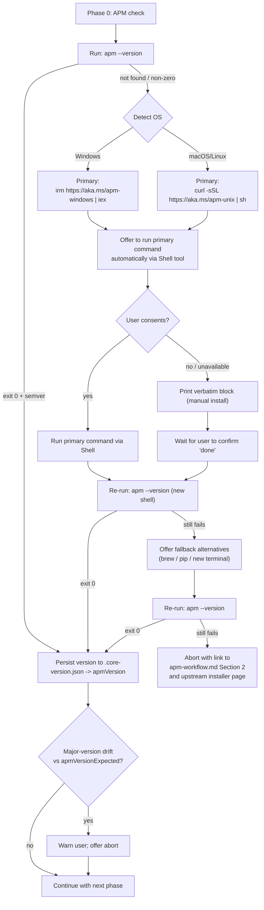

# Phase 0 — APM CLI Bootstrap

> Runs at the very start of every APM-aware flow (`/initialize`, `/quick-init`, `/package-new`, `/update-workplace`). Detects whether the APM CLI is installed and walks the user through installation if it is missing. Persists the detected version to `.opencode/rules/.core-version.json → apmVersion`.

This page lives next to `apm-workflow.md` Section 2 — it is the **operational checklist** the agent follows. `apm-workflow.md` is the conceptual reference.

> **Verified against APM 0.28.0 (2026-08-07; baseline recorded in `.opencode/rules/.core-version.json → apmVersionExpected`; smoke-tested with an isolated `apm-cli==0.28.0` install).** The install commands, consent flow, and PATH-refresh workarounds below are unchanged. Standing notes: on Windows the installer exposes a stable `current\apm.exe` that takes precedence on `PATH` (set `APM_TEMP_DIR` if AppLocker or endpoint protection blocks the default temp path), and `apm doctor` reports git / network / credential-resolution state (plus marketplace config and executable trust) when the gate fails for a non-obvious reason. If an `apm` binary is already present but outdated, prefer `apm self-update` over re-running this whole flow — it upgrades the existing install in place. **Exception:** `apm self-update` is disabled on `brew`-installed CLIs (and possibly `pip`), which print their own upgrade message instead — fall back to `brew upgrade microsoft/apm/apm` / `pip install --upgrade apm-cli` if `self-update` reports it can't run.

---

## Decision flow



---

## Procedure

### Step 1 — Detect

Run `apm --version` via the Shell tool. Capture stdout, stderr, and exit code.

| Result | Next step |
|---|---|
| Exit 0 AND stdout parses as `\d+\.\d+\.\d+` (semver) | Skip to Step 4 (persist + drift check). |
| Exit 0 but output not a semver | Treat as **broken install**; continue to Step 2 and ask the user to reinstall. |
| Non-zero exit code / command not found | Continue to Step 2. |

### Step 2 — Offer to install (with user consent)

> **CRITICAL — URL rule.** The agent MUST use the exact install commands from the table below **verbatim**. NEVER paraphrase the URLs, never substitute domains (e.g. `apm.run`, `install.apm.dev`, etc.), never invent a host name. The only authoritative source is <https://microsoft.github.io/apm/getting-started/installation/> (moved from `consumer/install-apm/` — the old path 404s as of APM 0.26.0), reproduced in this skill.

Detect the OS once (Windows: `$IsWindows` in PowerShell, `$env:OS` contains `Windows_NT`; macOS/Linux: `uname -s`). Then **offer to install automatically** using the platform's primary command via the Shell tool. Do not silently auto-execute — ask for explicit consent first.

**Authoritative install commands (do NOT modify):**

| OS | Primary (offered first) | Alternatives (offered on retry) |
|---|---|---|
| Windows (PowerShell) | `irm https://aka.ms/apm-windows \| iex` | `pip install apm-cli` |
| macOS / Linux | `curl -sSL https://aka.ms/apm-unix \| sh` | `brew install microsoft/apm/apm`, `pip install apm-cli` |

#### Step 2a — Ask for consent

Use this template (translated into the user's chat language). Pre-fill `<PRIMARY_COMMAND>` with the row from the table above that matches the detected OS:

```
APM CLI is required for AI Workplace v4 (it installs packages into .opencode/ during Phase 1.7-APM).
I can install it now by running the official one-liner:

    <PRIMARY_COMMAND>

Source: https://microsoft.github.io/apm/getting-started/installation/

Shall I run it? (yes / no — if no, I'll print the manual instructions instead)
```

#### Step 2b — On "yes": auto-install via Shell

1. Call the Shell tool with **exactly** `<PRIMARY_COMMAND>` from the table — copy the command character-for-character. Allow up to ~120 s; installer scripts download and unpack a binary.
2. Stream the output back to the user.
3. **Refresh the current shell's `PATH` from the OS environment** (the installer wrote the new entry to the **User** PATH in the registry / shell profile, but the agent's already-running shell session was inherited from the OpenCode parent process and won't see the update otherwise). Run **before** re-detecting:
   - **Windows / PowerShell** (the case most affected — OpenCode was started before install):
     ```powershell
     $env:PATH = [System.Environment]::GetEnvironmentVariable("PATH","Machine") + ";" + [System.Environment]::GetEnvironmentVariable("PATH","User")
     ```
   - **macOS / Linux / bash / zsh**: most installers append `export PATH="$HOME/.apm/bin:$PATH"` to `~/.bashrc` / `~/.zshrc` / `~/.profile`. The agent's non-login subshell won't auto-source them, so the agent must either:
     ```bash
     export PATH="$HOME/.apm/bin:$PATH"
     ```
     (additive — safe even if the entry is already there) or `source` the relevant rc file (`source ~/.bashrc 2>/dev/null || source ~/.zshrc 2>/dev/null || true`).
4. Continue to Step 3 (re-detect). The new `apm` binary lives in `~/.apm/bin` (Unix) or `%USERPROFILE%\.apm\bin` (Windows). If after the PATH refresh `apm` is still not on `PATH`, invoke it by **absolute path** as a final fallback — e.g. Windows: `& "$env:USERPROFILE\.apm\bin\apm.exe" --version`, Unix: `~/.apm/bin/apm --version`.

#### Step 2c — On "no" or auto-install failure: manual fallback

Print the verbatim block below. Do NOT modify or paraphrase any URL or command:

```
APM CLI install — manual instructions
=====================================
Run ONE of the following in a NEW terminal (so PATH is refreshed), then reply "done":

[Windows / PowerShell]    irm https://aka.ms/apm-windows | iex
                          pip install apm-cli                          (alternative)

[macOS / Linux]           curl -sSL https://aka.ms/apm-unix | sh
                          brew install microsoft/apm/apm               (alternative)
                          pip install apm-cli                          (alternative)

Reference: https://microsoft.github.io/apm/getting-started/installation/
```

Then wait for the user's "done" message before continuing.

### Step 3 — Re-detect (with mandatory PATH refresh first)

> **Why this matters.** If the user installed APM *while OpenCode was already running* (the most common case — they followed the agent's consent prompt), the **agent's child Shell session inherits PATH from the OpenCode parent process at the moment OpenCode was launched**, so it does not see the newly added `~/.apm/bin` entry. Re-launching the terminal in the OS shows `apm --version` working — re-running it via the agent does not. The fix is to refresh PATH inside the agent's session before re-detecting.

Detection ladder — try each step and stop on the first success:

| # | Detection command | Notes |
|---|---|---|
| 1 | `apm --version` | Plain check. If exit 0 + semver → done. |
| 2 | (Windows) `$env:PATH = [System.Environment]::GetEnvironmentVariable("PATH","Machine") + ";" + [System.Environment]::GetEnvironmentVariable("PATH","User"); apm --version` | Refresh PATH from registry, then check. This is the canonical fix for the "installed but not visible" symptom on Windows. |
| 2 | (Unix) `export PATH="$HOME/.apm/bin:$PATH"; apm --version` | Additive PATH update; harmless if already set. |
| 3 | (Windows) `& "$env:USERPROFILE\.apm\bin\apm.exe" --version` | Absolute path fallback. |
| 3 | (Unix) `~/.apm/bin/apm --version` | Absolute path fallback. |
| 4 | `python -m pip show apm-cli` / `py -3 -c "import apm_cli; print(apm_cli.__version__)"` | Only if the user installed via `pip install apm-cli`. |

Outcomes:

| Result | Next step |
|---|---|
| Any step exits 0 + semver | Proceed to Step 4. If success required PATH refresh or absolute path, mention to the user that they should open a new terminal once for `PATH` to settle, but the agent can keep going. |
| All steps fail | Offer the alternative install methods from the table (Step 2a → 2b once more, choosing an alternative). If that round also fails, abort the current flow, link to `apm-workflow.md` Section 2 (Troubleshooting row about `apm: command not found`), and tell the user to retry by re-issuing the original slash command. Do NOT mark Phase 0 complete. **Exception — `/quick-init`:** instead of aborting, record `apmAvailable=false`, print a one-line notice, and continue the workflow without the package offer (see "When to run Phase 0" below and quick-init.md Step 0). |

### Step 4 — Persist + drift check

On success:

1. Parse the detected semver as `apmVersion`.
2. Open `.opencode/rules/.core-version.json`. Set / overwrite:

   ```json
   {
     "apmVersion": "<detected>",
     "apmVersionCheckedAt": "<ISO timestamp>"
   }
   ```

   **Encoding requirement (CRITICAL):** write `.core-version.json` as UTF-8 without BOM and avoid a full PowerShell JSON round trip. On Windows PowerShell 5.1, `Get-Content` defaults to ANSI and `Set-Content -Encoding utf8` adds a BOM; together they can corrupt UTF-8 `description` / `notes` text (for example, `—` becomes `â€"`). Prefer the Write tool or Node `fs.writeFileSync(..., 'utf-8')`. If PowerShell is unavoidable, read and write explicitly:

   ```powershell
   $utf8NoBom = New-Object System.Text.UTF8Encoding $false
   $path = (Resolve-Path ".opencode/rules/.core-version.json").Path
   $json = [System.IO.File]::ReadAllText($path, $utf8NoBom)
   # Patch only apmVersion and apmVersionCheckedAt; do not ConvertTo-Json the whole file.
   [System.IO.File]::WriteAllText($path, $json, $utf8NoBom)
   ```

3. Read `apmVersionExpected` (if defined in `.core-version.json` — set during Workplace template releases). If the **major** segment differs from the detected one, warn:

   ```
   The installed APM CLI is <detected>, but this Workplace template was released against <expected>.
   Continuing may produce subtle install differences. Proceed anyway? (yes / no)
   ```

   If the user declines, abort Phase 0. **Exception — `/quick-init`:** treat the decline as `apmAvailable=false` (no abort) and continue the workflow without the package offer.

### Step 5 — Continue

Phase 0 is complete. Proceed to the next phase. The remainder of the initializer / updater flow may now call `apm install`, `apm compile`, `apm pack`, etc. without re-checking.

---

## When to run Phase 0

| Command / Trigger | Runs Phase 0? |
|---|---|
| `/initialize` | Yes — before Phase 1 (mode detection). |
| `/quick-init` | Yes — Step 0 of the workflow. **Graceful variant:** on total install failure / user decline / drift-warning decline, Quick Init does NOT abort — it records `apmAvailable=false`, prints a notice, and skips its role-agnostic package offer (quick-init.md Step 4.5). |
| `/package-new` | Yes — `apm compile --validate` and `apm pack --dry-run` both need the CLI. |
| `/update-workplace` | Yes — before refreshing the offline registry snapshot. |
| `/moduleActivate <pack>` | **Deprecated** — replaced by `/package-new` and direct `apm install` since v4.0.0. |

---

## Caching

After a successful Phase 0 within the same session, do NOT re-run `apm --version`. Cache the result in memory for the rest of the flow. On the next session a new Phase 0 runs because there is no in-process state.
