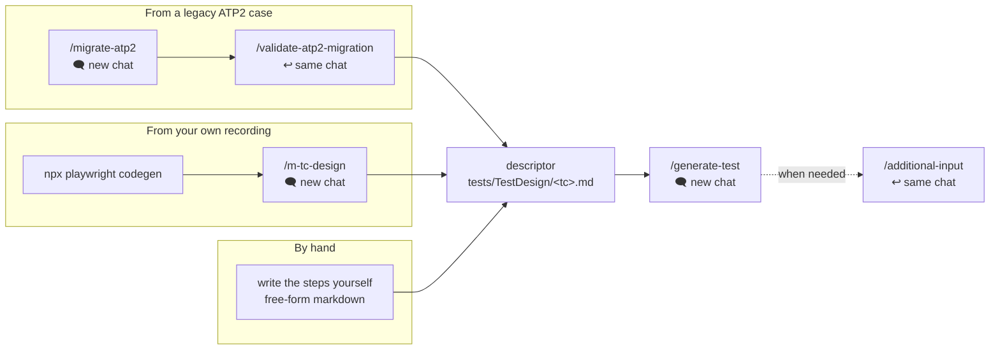

# TestGeneration — AI-Driven Playwright Test Automation

This folder is the runtime of the **`test-generation` APM package**. It contains the test framework (`SharedRuntime/`), the test project (`tests/`), and the environment configuration tooling.

**What you get:**

- **Layered architecture** — Test Scenario → Business Workflow → Page Object, with `AIPage`/`AIElement` as base classes
- **Cache-first locators** — `locator_cache.json` is consulted before any live element lookup
- **Non-UI surfaces** — `APIHelper` (REST/GraphQL/OAuth 2.0), `DatabaseHelper` (MySQL, PostgreSQL, MSSQL, MongoDB, Oracle), `SSHHelper`, `TDMHelper`
- **Hierarchical logging and reporting** — `TestLogger`, Playwright HTML report, Allure
- **Tag-based execution** — `TagHelper` + `TagConfiguration.json`
- **Environment configuration** — one generated JSON describing every system, resolved the same way locally and in pipelines

---

## Setup

### 1. Install dependencies and browsers

Run from **this folder** (`TestGeneration/`):

```bash
npm install
npx playwright install
```

### 2. Enable MCP servers in Cursor

Open **Cursor Settings → Tools & MCP → New MCP Server** and add the servers below.

**Playwright** — required. The research phase of `/generate-test` uses it to inspect live pages.

```json
{
  "mcpServers": {
    "Playwright": {
      "command": "npx",
      "env": {},
      "args": ["@playwright/mcp@latest", "--caps=testing"]
    }
  }
}
```

**atp-mcp** — required only for the ATP2 migration commands, which read everything from ATP through it. Fill in the values for your ATP instance and project; ask your team if you don't have them.

```json
{
  "mcpServers": {
    "atp-mcp": {
      "command": "npx",
      "args": ["-y", "@alexbuzo/atp-mcp@latest"],
      "env": {
        "ATP_BASE_URL": "<atp-public-gateway-url>",
        "ATP_KEYCLOAK_URL": "<atp-keycloak-url>",
        "ATP_REALM": "atp2",
        "ATP_CLIENT_ID": "frontend",
        "ATP_USERNAME": "<your-atp-user>",
        "ATP_PASSWORD": "<your-atp-password>",
        "ATP_PROJECT_ID": "<atp-project-uuid>"
      }
    }
  }
}
```

Save, enable the servers, and confirm they start without errors.

### 3. Configure the environment

Tests read their systems, URLs and credentials from a generated `environment-configuration.json`. It is produced from a committed template (`${PLACEHOLDER}` values) plus a gitignored yaml with the real values, so credentials stay out of git. Pipelines generate the same JSON, only at a different path — `SettingsHelper` looks for `/tmp/clone/environment-configuration.json` first, then the local `environment-configuration/local-environment-configuration/environment-configuration.json`, and falls back to the deprecated `ATP_ENVGENE_CONFIGURATION` variable last.

Follow [local-environment-configuration/LOCAL-SETUP.md](environment-configuration/local-environment-configuration/LOCAL-SETUP.md) to set it up; [environment-configuration/README.md](environment-configuration/README.md) documents the config structure itself. Once the file is generated, tests can be run immediately — no Cursor restart needed.

**Do this before you start generating tests, not just before running them.** The generation agents read the same config: it is how they resolve the `{{SYSTEM.field}}` placeholders in a descriptor and how they reach the live application to research locators. `/generate-test` checks for it during pre-flight and warns if it is missing.

---

## Project structure

```
<repository root>/
├── .cursor/                          # installed by APM
│   ├── commands/                     # slash-commands (/generate-test, /migrate-atp2, ...)
│   ├── agents/                       # subagents launched by the orchestrator
│   └── skills/                       # generation & migration knowledge base
├── .workplace/
│   └── test-generation/config.json   # module config: paths, test ID format, execution params
├── TestGeneration/                   # ← this folder
│   ├── SharedRuntime/                # framework core — do not edit unless you mean it
│   │   ├── AIPage.ts, AITomsPage.ts, AIElement.ts, BoundElement.ts
│   │   ├── LocatorCacheManagement.ts, TestLogger.ts, ConsoleCapture.ts
│   │   ├── SettingsHelper.ts, TagHelper.ts, TagRegistry.ts
│   │   ├── APIHelper.ts, ApiSession.ts, DatabaseHelper.ts, DatabaseAdapters.ts
│   │   ├── SSHHelper.ts, TDMHelper.ts, TDMRestApi.ts, TestFileHelper.ts
│   │   └── CleanStackReporter.ts, types.ts
│   ├── tests/
│   │   ├── TestDesign/               # test descriptors — the input for /generate-test
│   │   │   └── TestDesignPreparation/  # codegen recording + notes, the input for /m-tc-design
│   │   ├── Functional/               # Page Objects            ┐
│   │   ├── Business/                 # Business Workflows      │ generated
│   │   ├── TestScenario/             # test files (Playwright testDir)
│   │   ├── TestData/                 # data generators         ┘
│   │   ├── Settings/TagConfiguration.json   # allowed tags
│   │   ├── Utils/
│   │   │   ├── locator_cache.json    # cached element locators
│   │   │   └── TestTagsMapping.json  # test ID → tags
│   │   └── Raw/                      # gitignored working area
│   │       ├── Debug/                # logs & checkpoints — first place to look when something breaks
│   │       └── Report/               # HTML report, test-results.json, traces, videos, screenshots
│   ├── environment-configuration/    # templates, yaml values, setEnvironmentScript.ps1
│   ├── playwright.config.ts          # testDir, reporters, timeouts, chromium project
│   ├── global-setup.js               # loads environment configuration before the run
│   ├── package.json, tsconfig.json, .eslintrc.json, .prettierrc.json
│   └── run-playwright.js, start_tests.sh
└── .gitlab-ci.yml, Dockerfile.multistage, .gitlab/, app-chart/   # CI/CD & packaging
```

---

## Workflow

Everything converges on a **test descriptor** in `tests/TestDesign/<tc_name>.md`. There are three ways to get one, and one way to turn it into a test.



The third path is the simplest: write the test steps yourself in a markdown file under `tests/TestDesign/` and hand it to `/generate-test`. No rigid format is required — the more precise the steps, data rules and verifications, the less the agent has to guess.

Every command is a **phased process**: the main chat acts as an orchestrator and delegates the heavy work of each phase to a separate subagent. In chat you will see a sequence of subagent launches rather than one long monologue. Progress is written to `*Checkpoint.json`, so a re-run resumes from the last successful phase instead of starting over.

**Which model to pick:** `composer-2.5` is fast and good enough for all commands. `/validate-atp2-migration` is the one place where a stronger model can be worth it — it cross-checks against the raw ATP2 execution log, and a stronger model is more reliable at spotting missed steps.

| Command | Chat | Purpose |
|---|---|---|
| `/generate-test <path to descriptor>` | new | Generate the layered test, run it, drive it to green |
| `/migrate-atp2 <case URL> <execution URL>` | new | Collect the truth about a legacy ATP2 case and build a descriptor |
| `/validate-atp2-migration` | same as `/migrate-atp2` | Cross-check coverage against the raw execution and self-heal gaps |
| `/m-tc-design` | new | Turn a codegen recording + your notes into a descriptor |
| `/additional-input <what to fix>` | same as `/generate-test` | Steer an in-progress generation in plain language |

### `/generate-test` — generate the test

The main command. From a ready descriptor — migrated, recorded or hand-written — it generates the layered test (Page Objects → Business Workflows → Test Scenario), executes it, and iterates on failures until it passes.

```
/generate-test TestGeneration/tests/TestDesign/<tc_name>.md
```

**Phases:**

| # | Phase | What happens |
|---|---|---|
| -1 | Pre-flight | Reads the descriptor and config, checks the environment configuration and prerequisites before any work starts |
| 0 | Reusability analysis | Scans existing Page Objects, workflows and locators so the new test reuses what is already there |
| 1-2 | Locator research | Runs **only when the descriptor's Test Type contains `UI`**. Either inspects live pages through Playwright MCP, or extracts locators from a codegen recording when the descriptor carries locator hints |
| 3-4 | Code generation | Writes Page Objects, Business Workflows, the Test Scenario and data generators, then self-checks with `tsc` |
| 5 | Validation | Runs the test with Playwright and drives fix cycles until it passes; if it exhausts its cycles it stops and asks you whether to continue |

- **Produces:** code in `tests/Functional/`, `tests/Business/`, `tests/TestScenario/`, `tests/TestData/`; locators in `tests/Utils/locator_cache.json`; tags in `tests/Utils/TestTagsMapping.json`.
- **Where to look:** `tests/Raw/Debug/` — `ReusabilityAnalysis.md` (what was reused), `InvestigationLog.md` + `ElementsCollected.ts` (locators found), `ValidationLog.md` (the run: what failed and why), `GenerationCheckpoint.json` (phase progress). Reports land in `tests/Raw/Report/`.
- **Watch for:** the end of `ValidationLog.md` — the test should pass 100%. If the fix cycles keep looping on the same failure, step in with `/additional-input`.

### `/migrate-atp2` — migrate an ATP2 case

Collects the HTTP truth and environment from ATP2 and prepares the input package for generation. The test itself is **not** generated yet.

```
/migrate-atp2 <ATP2 case URL> <ATP2 execution URL>
```

**Both links are required.** The case URL identifies the test case; the execution URL (a PASSED execution request) supplies `projectId`, the executed test run and `executionRequestId` — without it the run cannot be collected and the environment cannot be exported.

**Phases:**

| # | Phase | What happens |
|---|---|---|
| 1 | Collection | Walks the ATP2 execution log and writes the step manifest, then fans out to per-callchain, per-compound and per-UI-group collectors (in batches) for HTTP contracts, UI steps and screenshots |
| 2 | Environment export | Exports the environment used by the run into a template plus a values yaml |
| 3 | Descriptor build | Reconciles hosts against the env and assembles the self-contained descriptor — one block per executed step, plus a `## Call Contracts` section holding the HTTP inlined from the collected contracts |
| — | Platform merge (conditional) | Only if Phase 3 found calls to ATP-platform systems missing from the env: merges them in and re-runs the descriptor build |

- **Produces:** the descriptor `tests/TestDesign/<tc_name>.md` — the only committed artifact of a migration — and the environment template `environment-configuration/environment-configuration-template-<env>.json` plus a matching `env-<env>.yaml`.
- **Where to look:** `tests/Raw/Debug/ATP2_Migration/<tc_name>/` — `mcp-data-collection.md` (the manifest of every executed step, the contract map, authorization), `contracts/` (the collected HTTP partials the descriptor inlines), and `MigrationCheckpoint.json` (phase-by-phase progress). All of it is gitignored working material.
- **Watch for:** the **unresolved-endpoints** list the command prints at the end, also written into `env-mapping.md` — if it is non-empty, some steps depend on systems you must resolve manually, and those steps carry a `Pending` line in the descriptor. Also check the "What is NOT yet collected" section in `mcp-data-collection.md`.
- **Next:** run `/validate-atp2-migration` in the same chat before handing the descriptor to `/generate-test`.

### `/validate-atp2-migration` — coverage check

Independently cross-checks the descriptor against the raw ATP2 execution: does the migration cover every step, and is there enough detail to reproduce the same test. It self-heals the gaps it finds and updates the descriptor.

**Phases:** a read-only *diagnosis* re-derives the executed ATP2 steps from the log and classifies each one as COVERED / PARTIAL / MISSING / NON-COLLECTABLE. If collectable gaps remain, *healing* re-runs the migration collection and descriptor build with a corrective focus on exactly those steps, then re-diagnoses. The heal → re-diagnose loop repeats up to three times before escalating to you.

- **Produces:** `MigrationValidation.md` in the same `ATP2_Migration/<tc_name>/` folder — a COVERED / PARTIAL / MISSING coverage table and the list of gaps with reasons; plus a `validation` entry in `MigrationCheckpoint.json`.
- **Watch for:** the `Regeneration-ready: yes/no` line, and any **NON-COLLECTABLE** items (e.g. non-HTTP actions) — those are flagged explicitly and are yours to decide. After this step the descriptor is ready for generation.

### `/m-tc-design` — descriptor from a recording

The recording path when there is no ATP2 case and you would rather not write the steps by hand. Record the flow, add notes, and let the command assemble a structured descriptor.

1. Record: `npx playwright codegen <URL>` → save the result to `tests/TestDesign/TestDesignPreparation/test-track.md`.
2. Write `tests/TestDesign/TestDesignPreparation/test-notes.md` with five sections: Test Name and Objective, Pages, Test Data, Notes (conditional steps, values carried between steps), Verifications.
3. Run `/m-tc-design`. It will ask for the output filename (`tc_<short_name>.md`).

- **Produces:** `tests/TestDesign/<tc_name>.md` — steps grouped by page, hardcoded URLs and credentials replaced with `{{System.field}}` placeholders resolved from your environment configuration.
- **Watch for:** the warning that none of the recorded URLs match the active environment configuration — it usually means the wrong env is generated.

### `/additional-input` — steer it mid-run

Intervene in an in-progress generation: correct a wrong fix, add a missing step, point the agent at the right file. Write in plain language.

```
/additional-input After step 8, verify the account status is "Active" before continuing.
```

- **Requires:** an active `GenerationCheckpoint.json` — an unfinished or recently failed `/generate-test` session.
- **Produces:** the change is routed through the same pipeline and generation resumes from the appropriate phase; the intervention is recorded as `user-intervention-N` in `GenerationCheckpoint.json`.
- **Watch for:** how the orchestrator **classified** your input before acting — if it misread the intent, rephrase.

### When something goes wrong

1. Open the relevant `*Checkpoint.json` — it tells you which phase you stopped at.
2. Read the debug file for that phase (see each command above) — it shows what was collected or generated and why it failed.
3. Re-run the command. It resumes from the last successful phase, not from scratch.

---

## Running tests

Run from this folder.

```bash
# All tests
npx playwright test

# A single test file
npx playwright test tests/TestScenario/LoginTest.test.ts

# Visible browser / interactive UI mode
npx playwright test --headed
npx playwright test --ui

# By tag
npx playwright test --grep "@smoke"
npx playwright test --grep "@critical"
npx playwright test --grep "@feature:login"
```

Reports:

```bash
npx playwright show-report tests/Raw/Report/html-reports

npm run allure:generate
npm run allure:open
```

Failure artifacts — screenshots, videos, traces and `test-results.json` — are written to `tests/Raw/Report/`.

**Happy testing.**
